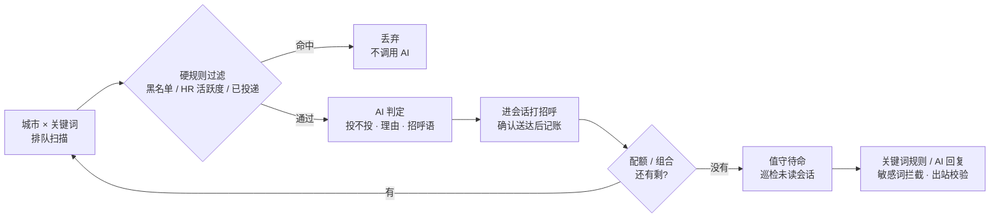
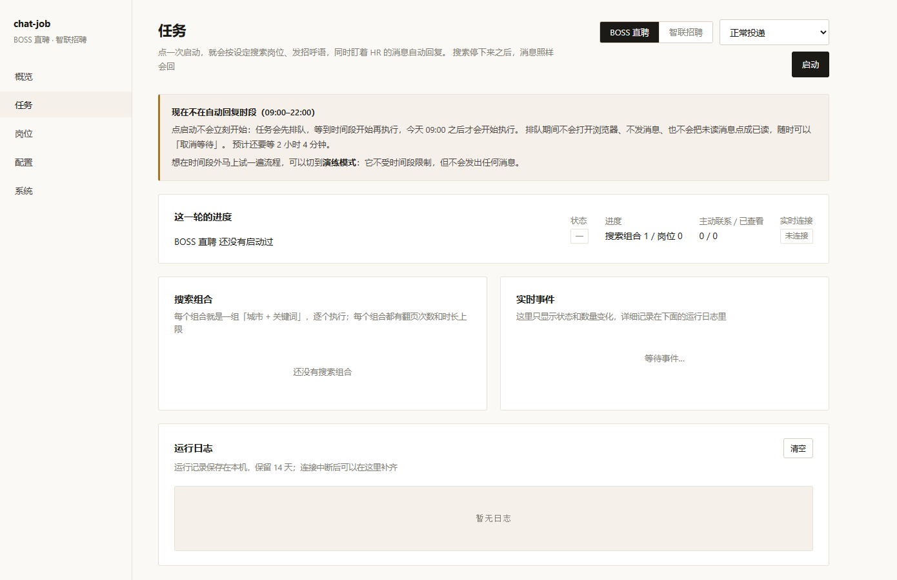
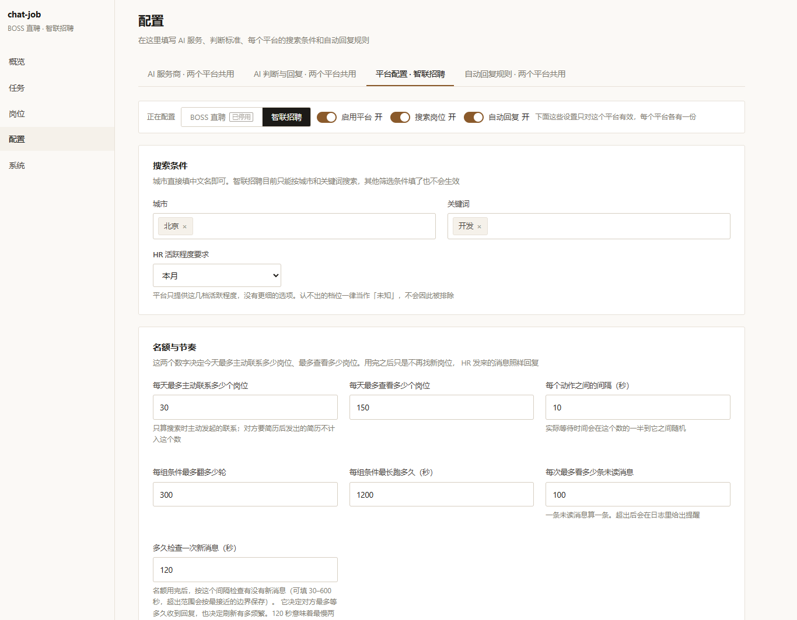

<div align="center">

# chat-job

**你自己 Windows 电脑上的找工作助手**

在真实浏览器里打开招聘平台，自动打招呼、投简历、回消息。

<br>

[](https://github.com/luochenfx/chat-job/releases/latest)
[](https://github.com/luochenfx/chat-job/releases)
[](https://github.com/luochenfx/chat-job/commits/main)
[](#使用边界与风险)
[](LICENSE)

[](https://adoptium.net/)
[](https://spring.io/projects/spring-boot)
[](https://nuxt.com/)
[](https://github.com/Kaliiiiiiiiii-Vinyzu/patchright)
[](https://www.sqlite.org/)

<br>

**[⬇ 下载绿色版](https://github.com/luochenfx/chat-job/releases/latest)** · [5 分钟上手](#第一次使用约-5-分钟) · [看截图](#项目截图) · [文档](docs/README.md) · [提 issue](https://github.com/luochenfx/chat-job/issues)

<sub>本项目纯 AI，0 手搓</sub>

</div>

---

| 🔒 **数据不出本机** | 🖥️ **不用配环境** | 🧵 **双平台并行** |
|:--:|:--:|:--:|
| <sub>数据库、登录态、API Key 都只在这台电脑上，密钥用 Windows 账户加密</sub> | <sub>绿色版自带 JRE、Node 和浏览器驱动，解压双击就能跑</sub> | <sub>BOSS 与智联各一条独立流水线，互不阻塞，可单独停用</sub> |

---

## 工作流程

一次「任务」就是一条按顺序执行的流水线。判定命中的岗位在进入 AI 之前就被丢掉，所以不花钱、不占配额：



配额或组合运行结束不会把任务结束掉，而是转到**值守待命**——搜索停下来，但 HR 回过来的消息照样回。

---

## 功能一览

### 扫描与投递

> 一轮任务 = 城市 × 关键词组合队列，逐个运行

- 组合排队扫描，支持断点续跑与卡片去重
- 六组筛选参数叠加收窄结果
- 日投递配额控制（每个平台各算一份）
- 已投递的岗位不会重复投，投递记录可查、可重置

### 筛选与判定

- **黑名单**：命中的公司与岗位关键词直接丢弃，不消耗 AI
- **偏好说明**：写「不接受外包」「不接受大小周」这类主观偏好，交给 AI 影响判断
- **质量开关**：关掉后用模板招呼语直接投，完全不调用 AI
- 命中即停的硬规则永远排在 AI 之前：黑名单 → HR 活跃度 → 已投递

### 值守（回消息）

> 收工后不退出，替你盯未读消息

- 按配置的时段自动巡检未读会话
- 命中就回复的关键词规则 + 文案池随机，同一组关键词可挂多条文案
- 敏感词（薪资、面试时间、联系方式等）优先拦截，命中整条不发
- 可选「AI 回复」开关（默认关），让 AI 替你回
- 单条回复不超过 60 字，发出前有四重出站校验
- 失败会重试 3 次，仍失败记为「已放弃」，可手动重试

### 看得见的运行状态

> 不用猜它是不是卡住了、卡在哪

- 控制台五页：**概览 / 任务 / 岗位 / 配置 / 系统**
- 任务页有实时事件流（SSE）与运行日志，能直接看到当前停在哪一步
- 等待期间也写「在等什么」：卡片间隔、待命巡检、时段外挂起都会显示在状态里
- 长时间没动静会标「可能已卡住」，区分「在等」与「无响应」
- 配了企业微信机器人时，异常 / 进入待命 / 时段结束会推送（三类开关默认全开）

---

## 支持的平台

| 平台 | 支持的能力与差别 |
|:---|:---|
| **BOSS 直聘** | ✅ 扫描 · ✅ 投递 · ✅ 值守回复<br>主力平台：招呼语可用 AI 生成或你自己写的模板；已沟通过的 Boss 可选是否再发一条（默认关） |
| **智联招聘** | ✅ 扫描 · ✅ 投递 · ✅ 值守回复<br>筛选条件当前只有**城市 × 关键词**；投递由平台发出简历与固定话术，没有自定义话术 |

两个平台可以同时跑：各自扫描、各自值守、各自一份浏览器登录态，一个出问题不影响另一个。不想跑某个平台，在「配置 → 平台配置」里停用它即可。

---

## 快速开始

|  | **绿色版**（推荐） | **从源码构建** |
|:--|:---|:---|
| 适合 | 只想用，不折腾环境 | 想改代码、自己打包 |
| 需要 | Windows 10/11 + 自带的 Edge 或 Chrome | JDK 21 / Maven / Node.js 22 |
| 三步 | 下载 → 解压到可写目录 → 双击 `start.bat` | `build.bat` → `start.bat` |

### 方式一：绿色版（什么都不用装）

包里已经带好 JRE、Node 和浏览器驱动，**不需要** JDK / Maven / Node.js。压缩包约 125MB，解压后约 209MB。

1. 下载分发包 → [**最新 release**](https://github.com/luochenfx/chat-job/releases/latest) 里的 `chat-job-<version>-win-x64.zip`
2. **解压到你有写权限的目录**，例如 `D:\chat-job`
3. 双击 `start.bat`
4. 等几秒，控制台会自动在浏览器打开：<http://127.0.0.1:8080/>（没自动打开就自己访问这个地址）
5. 想停止：直接关掉那个黑色命令行窗口

> [!WARNING]
> **不要解压到 `C:\Program Files`** 这类目录 —— 那里写不进数据库和浏览器配置。

换端口：`start.bat 8081`，或先 `set CHAT_JOB_PORT=8081` 再双击。

### 方式二：从源码构建

需要 **JDK 21**、**Maven**、**Node.js 22 + npm**（且都在 `PATH` 里）。首次构建要联网拉依赖。

在仓库根目录打开 **cmd**（双击 `.bat` 也可以）：

```bat
build.bat
start.bat
```

`build.bat` 会依次：装配浏览器驱动 → 生成控制台静态产物 → 打包后端 jar。
`start.bat` 会用 `java -jar` 起服务、绑定 `127.0.0.1:8080`，等服务就绪后再打开控制台页面。

---

## 第一次使用（约 5 分钟）

1. **系统页** → 确认浏览器驱动可用、浏览器能被识别；点「打开登录页」，在弹出的浏览器里扫码登录 BOSS 直聘，登录完回控制台点「探测登录」确认。
2. **配置页** → 添加一个模型；然后填写个人介绍与提示词，在「搜索条件」里填城市与关键词。
3. **任务页** → 先用 **演练模式** 运行一轮，看看组合队列、实时事件和运行日志。
4. 确认没问题，切 **正常模式** 正式运行。

> [!WARNING]
> **演练模式不是只读预览。** 只保证不投递、不回复，但仍然会浏览平台、调用 AI（消耗 token）、点开会话读消息 —— **点开即清未读红点，平台无法标回未读**。

---

## 项目截图

<table>
<tr>
<td width="50%"><br><sub><b>概览</b> · 今日投递 / 评估进度、三项自检灯、组合队列、最近一次运行</sub></td>
<td width="50%"><br><sub><b>任务</b> · 本轮进度、搜索组合、实时事件、运行日志；时段外会提示为什么还没开始</sub></td>
</tr>
<tr>
<td width="50%"><br><sub><b>配置</b> · 搜索条件、名额与节奏；每个平台一份，页面顶部切换平台</sub></td>
<td width="50%"><br><sub><b>系统</b> · driver 自检、登录态探测与扫码、告警通知、未读任务</sub></td>
</tr>
</table>

*截图为**未登录、无投递记录**时的空状态（首次启动的样子）；运行起来之后各卡片会填入岗位与计数。*

---

## 数据在哪 / 怎么备份

全部数据就在两个目录里，都在你解压/克隆的那个文件夹下：

| 目录 | 内容 | 注意 |
|:---|:---|:---|
| `data\` | 数据库 `chat-job.db` 与日志 `logs\chat-job.log` | 配置、投递记录、未读任务都在这里 |
| `browser-data\<平台>\` | 各平台的浏览器登录态（专用 profile，如 `boss\`、`zhaopin\`） | 体积几百 MB 属正常 |

- **备份** = 复制这两个目录。
- **卸载** = 删掉整个文件夹。不写注册表、不留后台服务、不装系统驱动。

> [!CAUTION]
> **不要把 `data\` 拷给别人**：里面的 API Key 与 Cookie 用 Windows 账户加密（DPAPI），换台电脑或换个 Windows 用户都解不开，对方只会看到「未配置」；而 `browser-data\` 里存的是登录态，交出它等于交出账号的访问权限。

---

## 使用边界与风险

| 本项目会做 | 本项目不会做 |
|:---|:---|
| 在你本机起一个专用浏览器，用你自己的登录态操作 | 不提供多账号切换、云部署、代理池 |
| 按你的筛选条件扫描、判定、投递，按你的规则回消息 | 不识别验证码、不绕过平台风控：掉登录或遇验证就停机 |
| 把岗位信息发给你**自己配置**的模型服务 | 不把数据上传给本项目作者，也没有任何中转服务器 |

- 这是**自用单机工具**，账号风险由使用者自行承担。
- 它会在第三方平台上执行**真实操作**。请用小号操作、保留默认配额与随机间隔。

---

## 许可证

以 [Apache License 2.0](LICENSE) 发布

---

## 文档与反馈

改代码、调接口、查默认值、翻排错表 —— 都在 [`docs/README.md`](docs/README.md)。

- 用起来有问题、想要某个能力 → [提 issue](https://github.com/luochenfx/chat-job/issues)
- 术语口径与设计取舍 → [`CONTEXT.md`](CONTEXT.md)、[`docs/adr/`](docs/adr/)、[`docs/spec/`](docs/spec/)

<div align="center">
<sub>自用工具，不收集数据 —— 你看到的就是它的全部。</sub>
</div>
