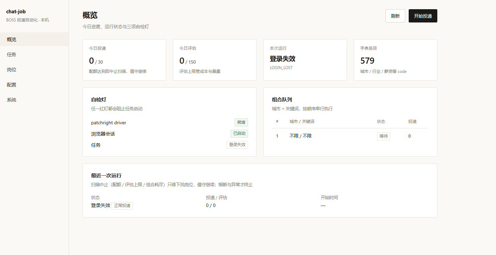
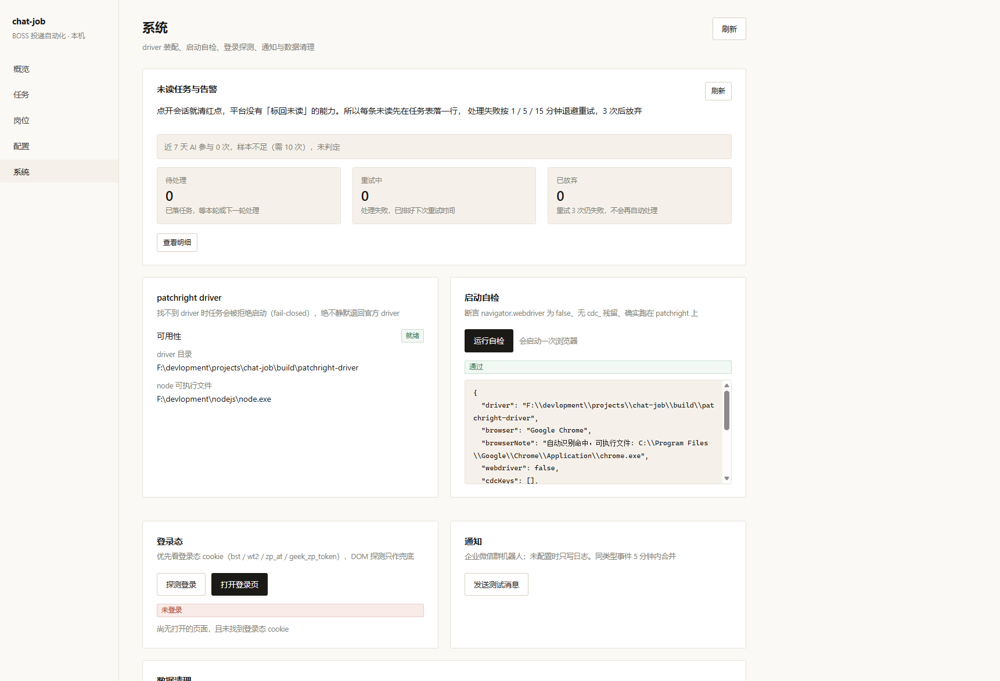
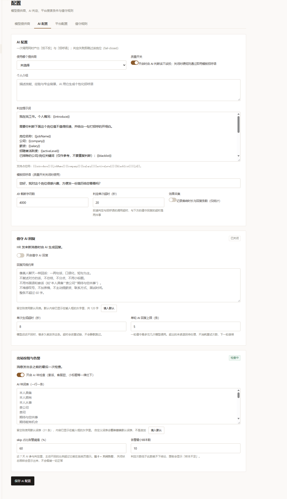
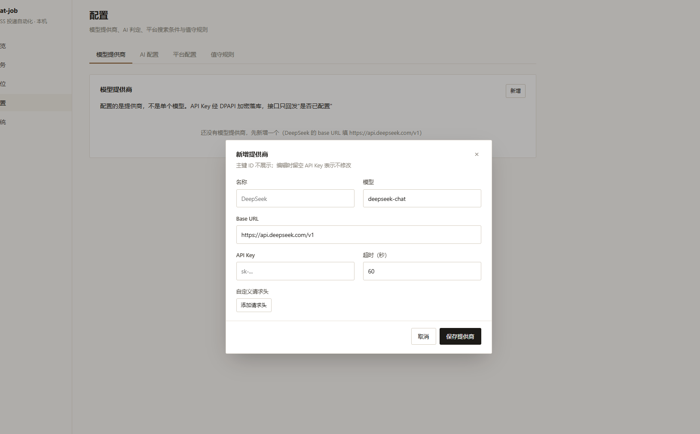

# chat-job

**跑在你自己 Windows 电脑上的找工作助手。**

浏览器打开平台，没有账号体系、不上传任何数据 —— 你的简历、聊天、API Key 都只留在这台电脑里。

**本项目代码由 AI 生成，无手工编写**

## 目录

- [功能](#功能)
- [快速开始](#快速开始)
- [第一次使用（约 5 分钟）](#第一次使用约-5-分钟)
- [数据在哪 / 怎么备份](#数据在哪--怎么备份)
- [使用边界与风险](#使用边界与风险)
- [文档](#文档)

---


## 功能

**扫描与投递**

- 城市 × 关键词组合排队扫描，支持断点续跑、卡片去重
- 六组筛选参数叠加收窄结果
- 日投递配额控制
- 已投递的岗位不会重复投，投递记录可查

**决策**

- 黑名单：命中的公司与岗位关键词直接丢弃，不消耗 AI
- 偏好说明：写「不接受外包」「不接受大小周」这类主观偏好，交给 AI 影响判断
- 质量开关关闭时，用模板招呼语直接投，不调用 AI

**值守（回复消息）**

- 按配置的时段自动巡检未读会话
- 命中就回复的关键词规则 + 文案池随机，同组关键词可挂多条
- 敏感词（薪资、面试时间、联系方式等）优先拦截，命中整条不发
- 可选「AI 回复」开关，让AI帮你回复
- 单条回复不超过 60 字；发出前有四重出站校验

**看得见的运行状态**

- 控制台五页：概览 / 任务 / 岗位 / 配置 / 系统
- 任务页有实时事件流与运行日志，可直接看到当前停在哪一步
- 等待期间状态可视化：卡片间隔、待命巡检、时段外挂起都会显示在状态中
- BOSS 直聘与智联招聘可同时运行：各自扫描、各自值守，一个平台出问题不影响另一个；不想跑某个平台可在「配置 → 平台配置」里停用它

---

## 快速开始

### 方式一：绿色版（推荐，什么都不用装）

适合只想用、不想折腾环境的人。机器只需要 Windows 10/11 + 自带的 Edge（或 Chrome）。

1. 下载分发包  [](https://github.com/luochenfx/chat-job/releases/latest)
2. **解压到你有写权限的目录**，例如 `D:\chat-job`
   不要放在 `C:\Program Files` 下 —— 那里写不进数据库和浏览器配置
3. 双击 `start.bat`
4. 等几秒，控制台会自动在浏览器打开：<http://127.0.0.1:8080/>
   没自动打开就自己访问这个地址
5. 想停止：直接关掉那个黑色命令行窗口

换端口：`start.bat 8081`，或先 `set CHAT_JOB_PORT=8081` 再双击。

包里已经带好 JRE、Node 和浏览器驱动，**不需要** JDK / Maven / Node.js。

### 方式二：从源码构建

需要 **JDK 21**、**Maven**、**Node.js 22 + npm**（且都在 `PATH` 里）。首次构建要联网拉依赖。

在仓库根目录打开 **cmd**（双击 `.bat` 也可以）：

```bat
build.bat
start.bat
```

`build.bat` 会依次：装配浏览器驱动 → 生成控制台静态产物 → 打包后端 jar。

`start.bat` 会用 `java -jar` 起服务、绑定 `127.0.0.1:8080`，等服务就绪后再打开控制台页面。

---

## 第一次使用（约 5 分钟）

1. **系统页** → 确认「patchright driver」是绿灯、浏览器能被识别；点「打开登录页」在弹出的浏览器里扫码登录 BOSS 直聘，登录完回控制台点「探测登录」确认。
   这个浏览器窗口是专用 profile，和日常用的浏览器互不影响。每个平台各有一份独立 profile：启用智联后，还要在系统页对「智联招聘」那一行单独扫码登录一次，Boss 的登录态不会共享过去。
2. **配置页** → 添加一个模型（模型名称 / 服务商 / 接口地址 / 密钥）。同一服务商要用多个模型就再加一条，只改模型名称；然后填写个人介绍与提示词，在「搜索条件」里填城市与关键词。
3. **任务页** → 先用 **演练模式（DRY_RUN）** 跑一轮，看看组合队列、实时事件和运行日志。
4. 确认没问题，再切 **正常模式（NORMAL）** 正式跑。时段外点启动不会立刻执行，任务会显示「等待值守时段」，到点自动开工。

> **演练模式不是只读预览。** 只保证不投递、不回复，但仍然会浏览平台、调用 AI（消耗 token）、点开会话读消息 —— **点开即清未读红点，平台无法标回未读**。

---
## 项目截图





## 数据在哪 / 怎么备份

全部数据就在两个目录里，都在你解压/克隆的那个文件夹下：

| 目录 | 内容 | 注意 |
|---|---|---|
| `data\` | 数据库 `chat-job.db` 与日志 `logs\chat-job.log` | 配置、投递记录、未读任务都在这里 |
| `browser-data\<平台>\` | 各平台的浏览器登录态（专用 profile，如 `boss\`、`zhaopin\`） | 体积几百 MB 属正常 |

- **备份** = 复制这两个目录。
- **卸载** = 删掉整个文件夹。不写注册表、不留后台服务、不装系统驱动。
- **不要把 `data\` 拷给别人**：里面的 API Key 与 Cookie 用 Windows 账户加密（DPAPI），换台电脑或换个 Windows 用户都解不开，对方只会看到「未配置」；而 `browser-data\` 内存的是登录态，交出它等于交出账号的访问权限。

---

## 使用边界与风险

- 这是**自用单机工具**：不提供多账号、云部署、代理池、验证码识别。
- 它会在第三方平台上执行**真实操作**。请先用小号试跑、保留默认配额与随机间隔。
- 账号风险由使用者自行承担。

---

## 文档

改代码、调接口、查默认值、翻排错表 —— 都在 [`docs/README.md`](docs/README.md)。
